**把好奇心写成代码，把想法做成现实。**

[GitHub ↗](https://github.com/hyc3z) · [Repositories ↗](https://github.com/hyc3z?tab=repositories) · [Activity ↗](https://github.com/hyc3z?tab=overview)

 

## 01 / THE MINDSET

喜欢研究系统如何运转，也喜欢动手改变它们。关注 AI、开发工具与开源，在实验中寻找值得继续构建的东西。

> **Stay curious. Make it work. Make it yours.**

 

## 02 / EXPLORATION ZONES

| 方向 | 兴趣所在 |
| :--- | :--- |
| **AI & Agents** | 从模型能力到真实工作流，探索智能系统的边界。 |
| **Systems & Tools** | Linux、自动化与开发体验，让工具顺着自己的思路工作。 |
| **Web & Experiments** | 把点子快速变成可运行的原型，在实际使用中迭代。 |
| **Open Source** | 阅读、拆解、改造，也把自己的探索留给后来的人。 |

 

## 03 / TOOLBOX

  

## 04 / FOLLOW THE WORK

代码、实验与持续更新，都在 [公开仓库](https://github.com/hyc3z?tab=repositories) 中。

 

**LESS TEMPLATE. MORE PERSONALITY.**

hyc3z / curiosity in progress

